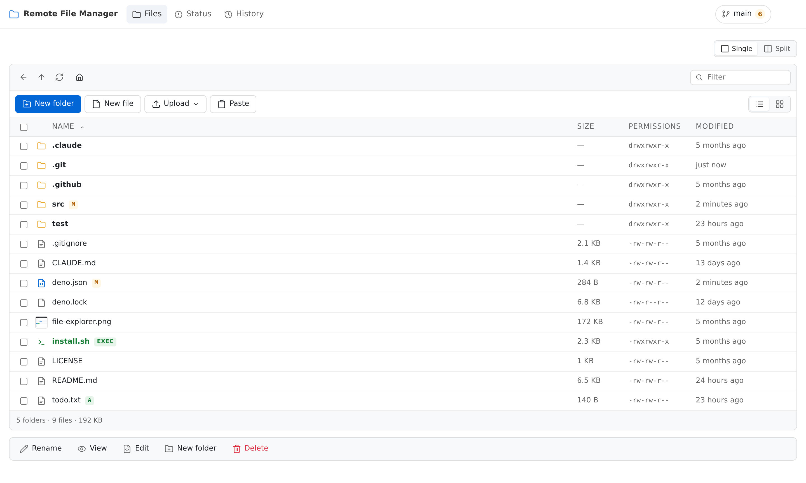

# Remote File Manager

Website: https://sobanieca.github.io/remote-file-manager/

A web-based file management system that provides HTTP server functionality for
browsing and managing files on remote machines. The application creates a
`/file-explorer` endpoint that enables comprehensive file operations within the
working directory.

## Overview

Remote File Manager is designed to streamline file management operations on
remote servers through a web interface. The tool combines static HTTP server
capabilities with dynamic file management features, making it particularly
valuable for remote server administration and development workflows.

## Key Features

- **Web-based File Explorer**: Detail view with file size, Unix permissions,
  modification time and highlighted executables and symlinks
- **Dual-pane Mode**: Norton Commander style split view with a command bar for
  copying and moving between panes
- **File Management Operations**: Create, delete, rename, copy, move and
  organize files and folders, with multi-select and bulk actions
- **Sorting, Filtering and Views**: Sort by name, size or date, filter the
  listing live, and switch between list and icon grid
- **Fuzzy Search**: Find any file or folder below the served directory with
  `Ctrl`/`Cmd` + `P`, open it or reveal it in the explorer
- **Source Code Viewer**: Syntax highlighted, line numbered viewer with linkable
  lines and copy
- **Previews**: Rendered markdown (including tables), HTML, images, video, audio
  and PDF files
- **Text File Editing**: Editor with live syntax highlighting, line numbers,
  auto-indent and `Ctrl+S` saving
- **Git Integration**: Branch indicator, working tree status overview, commit
  history, and diffs in inline or side-by-side mode
- **Worktrees**: See every worktree of the repository and switch the served
  directory to any of them from the app bar or the status page
- **Commit Comparison**: Pick any two commits and review everything that changed
  between them
- **Clipboard Upload**: Paste screenshots and images directly from clipboard to
  upload files, or drop files into the upload dialog
- **Static File Serving**: Serves HTML files and other static content
- **Remote Access**: Optimized for SSH port forwarding scenarios
- **Light and Dark Themes**: Follows the system preference, switchable from the
  app bar



### Keyboard Navigation

File actions live in the command bar below the panes and in the per-entry menus.
The keyboard is used for moving around a listing:

| Key                | Action                        |
| ------------------ | ----------------------------- |
| `↑` / `↓`          | Move between entries          |
| `Enter`            | Open the focused entry        |
| `Space`            | Toggle selection              |
| `Shift` + `↑`/`↓`  | Extend the selection          |
| `Tab`              | Switch pane in split view     |
| `Backspace`        | Go to the parent directory    |
| `Delete`           | Delete the selected entries   |
| `Esc`              | Clear the filter box          |
| `Ctrl`/`Cmd` + `A` | Select everything in the pane |
| `Ctrl`/`Cmd` + `S` | Save the file in the editor   |
| `Ctrl`/`Cmd` + `P` | Search files everywhere       |

### Search

The filter box in a pane narrows the current folder. To find something anywhere
below the served directory press `Ctrl`/`Cmd` + `P` or click **Search files** in
the app bar. Matching is fuzzy, so `fexp` finds
`src/endpoints/file-explorer.js`, and several words can be combined. `Enter`
opens the entry, `Shift` + `Enter` reveals it in the file explorer.

### Git Worktrees

When the repository has more than one worktree, the branch chip in the app bar
opens a list of them and the git status page shows them with their branch and
HEAD. Switching makes the server serve that worktree instead. If you started
`rfm` in a sub directory of the repository, the same sub directory of the other
worktree is served when it exists.

## Installation

`rfm` is a single binary for Linux and macOS (x64 and arm64). No runtime is
needed, only `git` for the git features.

### Option 1: Quick Install Script (Recommended)

```bash
curl -fsSL sobanieca.github.io/remote-file-manager/install.sh | bash
```

This script automatically detects your OS and architecture (Linux/macOS,
x64/arm64) and installs the appropriate binary to `/usr/local/bin`, for all users. If you
can't write to `/usr/local/bin`, the script stops with an error. Run it with
`sudo`:

```bash
curl -fsSL sobanieca.github.io/remote-file-manager/install.sh | sudo bash
```

Or install to a custom location: set `INSTALL_DIR` to a directory that is on
your `PATH`:

```bash
curl -fsSL sobanieca.github.io/remote-file-manager/install.sh | INSTALL_DIR=~/.local/bin bash
```

### Option 2: Manual Binary Installation

Download the latest binary for your operating system from the
[releases page](https://github.com/sobanieca/remote-file-manager/releases/latest):

**Example for Linux x64:**

```bash
curl -L -o rfm https://github.com/sobanieca/remote-file-manager/releases/latest/download/remote-file-manager-linux-x64
chmod +x rfm
sudo mv rfm /usr/local/bin/
```

Available binaries: `remote-file-manager-linux-x64`,
`remote-file-manager-linux-arm64`, `remote-file-manager-macos-x64`,
`remote-file-manager-macos-arm64`

### Migrating from the Deno version (0.x)

Versions up to 0.10 were distributed for Deno (`jsr:@sobanieca/remote-file-manager`).
Remove the Deno installation with `deno uninstall -g rfm` and install the binary
as described above. The saved port is not carried over, start `rfm -p <port>`
once to remember it again.

## Usage

Navigate to your desired working directory and execute:

```bash
rfm
```

The server will start and provide access to the file management interface
through your web browser on default port (4000). It listens on 127.0.0.1 only,
so other machines cannot connect to it directly. Use SSH port forwarding (see
below) to open it from another machine.

### Custom Port

To change port execute:

```bash
rfm -p 5432
```

**Note**: The application remembers the last used port (in
`~/.config/rfm/settings.json`), so you don't need to specify it on subsequent
runs unless you want to change it again. `rfm -p 4000` goes back to the default.

### Update

To update Remote File Manager to the latest version:

```bash
rfm update
```

This downloads the latest release and replaces the binary. If `rfm` is installed
in a system directory (like `/usr/local/bin`) run `sudo rfm update`. `rfm`
checks for new versions once a day and prints a notice when one is available
(set `RFM_NO_UPDATE_CHECK=1` to disable it).

## Remote File Management with SSH Port Forwarding

Remote File Manager is particularly useful when managing files on remote servers
through SSH connections. By using SSH port forwarding, you can securely access
the web interface from your local machine.

### Setting up SSH Port Forwarding

To access Remote File Manager running on a remote server from your local
machine, use SSH with the `-L` option to forward a local port to the remote
server:

1. **Connect to the remote server with port forwarding:**
   ```bash
   ssh -L 4000:localhost:4000 user@remote-server.com
   ```

2. **Navigate to your target directory on the remote server:**
   ```bash
   cd /path/to/your/project
   ```

3. **Start Remote File Manager:**
   ```bash
   rfm
   ```

4. **Access the file manager from your local browser:** Open
   `http://localhost:4000/file-explorer` in your local web browser

## Development

The repository holds two parts:

- `src/` - the Rust server. It serves the files of the working directory and a
  JSON API under `/api`.
- `ui/` - the browser app, a single page application built with imp. It is
  served at `/file-explorer` and routes in the URL fragment, for example
  `/file-explorer#/view?path=README.md`.

The built app is embedded into the binary from `src/ui-assets/`, so the release
binaries need nothing else at runtime. Development tasks are cargo aliases:

| Command                 | Does                                                                     |
| ----------------------- | ------------------------------------------------------------------------ |
| `cargo rfm [args]`      | Runs `rfm` from source in the current directory                          |
| `cargo verify`          | Formatting, lints and all tests (run before committing, CI runs it)      |
| `cargo dev`             | Builds the UI and starts the server in `test/`                           |
| `cargo build-ui`        | Builds `ui/` with imp and embeds it into `src/ui-assets/`                |
| `imp test --unit`       | Runs the unit tests of the UI (from `ui/`)                               |
| `imp test --e2e --mock` | Runs the browser tests of the UI against mocked API answers (from `ui/`) |

Run `imp skill` inside `ui/` to learn the framework, and `imp lint` and
`imp fmt` after changing the UI. Commit the regenerated `src/ui-assets/` and
`src/ui_assets.rs` together with the UI change.
